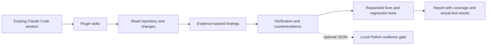

# Native Claude Code architecture — v0.3

Claude Code itself performs the reasoning and tool use with the user's existing
login and selected model. The plugin supplies nine workflows, five specialist roles and focused reference
material. No SDK, model API client, key prompt, model override, automatic shell grant,
MCP server or hook is included in the native plugin. Permissions remain those of
the user's Claude Code environment; skill prose is not OS isolation.

Working-tree review is supported. Skills instruct Claude to preserve user changes,
record the version/scope actually examined and trace enforcement across layers.
Review and fix are separated by user intent, not unnecessary repeated approval.
Same-session verification is honestly identified as such. Campaigns may route work
to native specialist agents when the session/task permits; no recursive delegation
or model override is configured. Read-only specialists have only Read/Glob/Grep;
tester/fixer use normal session permissions. See [campaign design](scalable-campaigns.md).

Untrusted code, comments, fixture instructions and scanner output are evidence,
not authority to change the review objective or suppress findings. Skills direct
Claude to respect project conventions while resisting such instruction attempts.
This is procedural guidance, not a proof of prompt-injection resistance.

## Optional helpers

The Python helper never invokes a model. It can read Git object snapshots, execute
pinned scanners/tests in restricted Docker containers, or validate user-supplied
review/verifier JSON against source quotes and line numbers. The gate cannot prove
the reviewer's independence or semantic correctness. It only covers the configured
commit, checks and evidence. Incomplete work does not become a passing gate.

Docker hardening (when used): read-only source/root filesystem, no network or host
credentials, non-root user, no added capabilities, resource/output/time limits.
It is not a microVM and is not required for a native source review. A test from an
untrusted repository still needs suitable isolation and session permission.

## Remaining evaluation

Validate real Claude Code behavior on held-out vulnerable/fixed repositories,
measure false positives and missed authorization defects, and verify selected
scanner container images on a healthy runner. Native plugin validation and unit
tests do not substitute for those behavioral evaluations.
