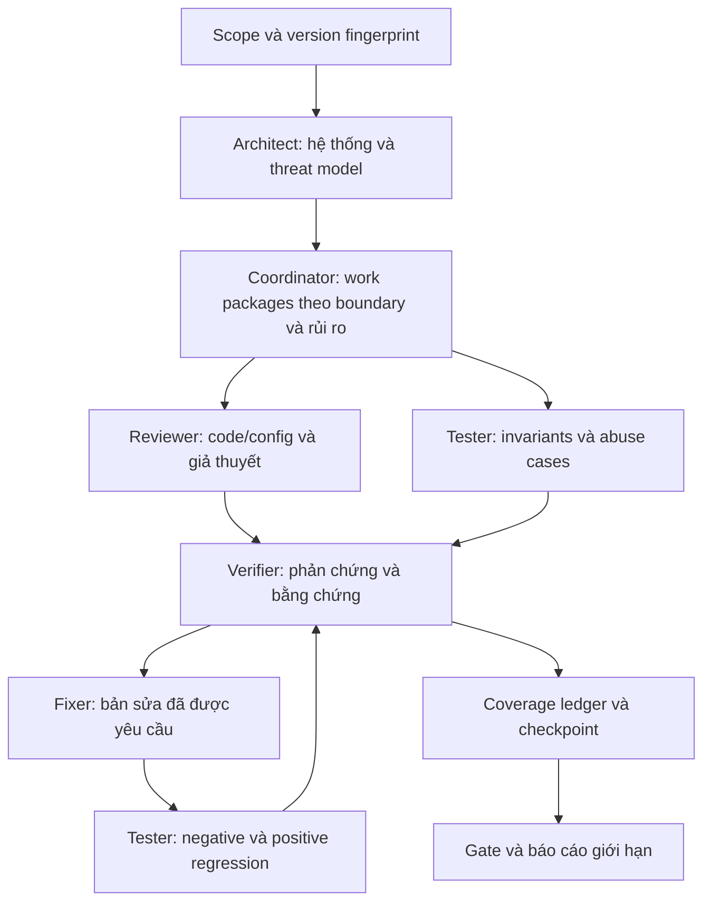

# Security campaigns cho dự án lớn — v0.3

## Mục tiêu và giới hạn

Harness chạy trong Claude Code bằng phiên đăng nhập hiện có. Phiên chính điều phối
scope, chuyên gia, test và bằng chứng. Không yêu cầu API key hoặc hạ tầng gọi model.
Skills/agents cung cấp quy trình và giới hạn tool phù hợp; không thay thế sandbox
của hệ điều hành hoặc permission của Claude Code.

Thiết kế bao phủ nhiều nhóm rủi ro nhưng không thể bảo đảm kiểm tra **mọi** kiểu tấn
công. Báo cáo phải chỉ ra phạm vi thực tế, các giả định, test đã chạy và phần thiếu.



## Chia công việc khi scale

Đơn vị phân chia là luồng bảo mật/trust boundary: ví dụ API invoice -> service ->
database; hoặc checkout -> queue -> worker -> payment provider. Không chia ngẫu
nhiên theo số file vì sẽ bỏ sót enforcement và lỗi tích hợp giữa service.

Mỗi work package có version, mục tiêu/invariant, file/symbol tham chiếu, phạm vi
được sửa/chạy, dữ liệu giả, giới hạn thời gian/tài nguyên, artifact cần trả và điều
kiện hoàn thành. Các module auth, tenancy, serializer và shared clients cần đánh
giá tác động đến mọi consumer. Cache/index/blob/queue đều là boundary cần xét.

Coordinator mặc định không dùng quá ba worker đồng thời; có thể giảm theo context,
rate limit và tài nguyên. Chỉ song song các việc đọc hoặc môi trường test đã cô lập.
Mỗi worker có namespace test riêng; mọi cập nhật ledger do coordinator tổng hợp.
Worker không tự tạo thêm worker. Không gộp "module đã xong" thành "hệ thống đã xong"
khi cross-service contracts chưa được kiểm chứng.

## Vai trò tester

Tester có nhiệm vụ tạo và thực thi test khi scope cho phép, không chỉ liệt kê test.
Trước mỗi ca, xác định identity, trạng thái ban đầu, action, oracle và các side effect
bị cấm. Cần cả ca bị từ chối lẫn ca hợp lệ để tránh bản sửa chặn tất cả người dùng.

Các lớp kiểm tra gồm static, unit/property, integration/contract, end-to-end,
stateful/replay, fault/concurrency, bounded fuzzing và regression sau sửa. Domain
catalogue gồm 18 nhóm: authn, authz, tenant isolation, injection, browser, network,
files, crypto/secrets, privacy, business logic, concurrency, resilience, protocols,
infrastructure, supply chain, detection/response, AI-agent và memory safety.

Không nhất thiết chạy mọi công cụ trên mọi dự án. Mỗi domain phải có quyết định
applicable/N/A/unknown. Thiếu môi trường/tool là blocked hoặc chưa kiểm tra, không
phải N/A. Có hướng dẫn riêng cho web/API, SaaS, distributed workers, cloud/CI,
native code và AI agents trong skills/test/references/stack-profiles.md.

## AI-agent threat testing

Kiểm tra prompt injection trực tiếp/gián tiếp; forged tool output; tool escalation;
approval replay và thay arguments sau approval; memory/RAG xuyên tenant; skill/MCP
bị thay đổi; exfiltration qua tool; delegation vượt quyền; vòng lặp vượt budget;
output model đi vào SQL/shell/HTML; giả mạo kết quả audit.

Dùng canary giả và mock side-effect tools. Quan sát tool event và dữ liệu thực tế,
không chỉ câu trả lời "tôi từ chối". Tách chất lượng phản hồi của model khỏi kiểm
soát thực thi ở broker/filesystem/network. Test phải giữ được tác vụ hợp lệ.

## Tiếp tục qua nhiều phiên

Checkpoint lưu các work package, findings, test IDs, evidence paths, giả định,
phạm vi còn thiếu và next actions. Scope fingerprint bao gồm commit, dirty content,
effective configuration và fixtures. Sau khi thay code/config/fixture, invalidation
lan tới các consumer/contract liên quan. Không xác định được ảnh hưởng thì làm mới
toàn bộ campaign; không sửa nhãn version trên log cũ.

Lệnh `/security-harness:resume <run-path>` yêu cầu Claude kiểm tra drift trước khi
dùng lại bằng chứng. Các quyết định vẫn thuộc phiên hiện tại; nội dung checkpoint
không tự cấp thêm quyền. Helper tùy chọn dùng một fingerprint toàn campaign để
phát hiện stale records; selective invalidation hiện là quy trình do Claude thực
hiện, chưa phải dependency graph engine tự động.

## Ledger kiểm chứng được

Ví dụ tạo campaign hai bề mặt (36 ô coverage):

```powershell
python "C:\tools\claude-security-harness\skills\campaign\scripts\campaign_state.py" init `
  --out C:\audits\project\run-001 --scope COMMIT_PLUS_DIRTY_CONFIG_FIXTURE_HASH `
  --surfaces api worker
```

Sau khi Claude ghi kết quả thật vào ledger theo state-contract.md:

```powershell
python "C:\tools\claude-security-harness\skills\campaign\scripts\campaign_state.py" check `
  C:\audits\project\run-001 --scope CURRENT_SCOPE_FINGERPRINT
```

Script chỉ dùng stdlib, không gọi model và không thực thi tests. Nó kiểm tra các ô
coverage, ID/reference, artifact path/hash, version, trạng thái và các control.
Kết quả: PASS=0, BLOCK=2, INCOMPLETE=3, REVIEW=4. High/Critical được hỗ trợ bằng
bằng chứng vẫn BLOCK dù coverage còn thiếu. Gate campaign giữ các finding mức thấp
đang mở ở REVIEW; chặt hơn helper commit v0.2 vốn cho phép finding thấp/trung bình.

Ledger do người dùng/agent ghi nên có thể bị làm giả. Hash chỉ chứng minh artifact
khớp giá trị đã khai báo. Nó không chứng minh nội dung đúng, không tự tính đầy đủ
scope fingerprint, không chứng minh reviewer độc lập và không thể chống tác giả
độc hại sửa cả log lẫn hash. Muốn provenance mạnh hơn cần runner/CI tin cậy và lưu
artifact bất biến bên ngoài workspace có thể ghi.

## Đánh giá chất lượng

Giữ các repo known-bad/known-good và tập held-out. Đo recall/precision theo domain,
false positive, tỷ lệ tái hiện, test mutation effectiveness, fix regression, chi phí
và thời gian. `evals/campaign-scenarios.json` cung cấp tám tình huống đánh giá hành
vi thực tế; chưa có kết quả benchmark Claude từ các tình huống đó.
